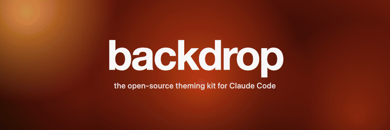
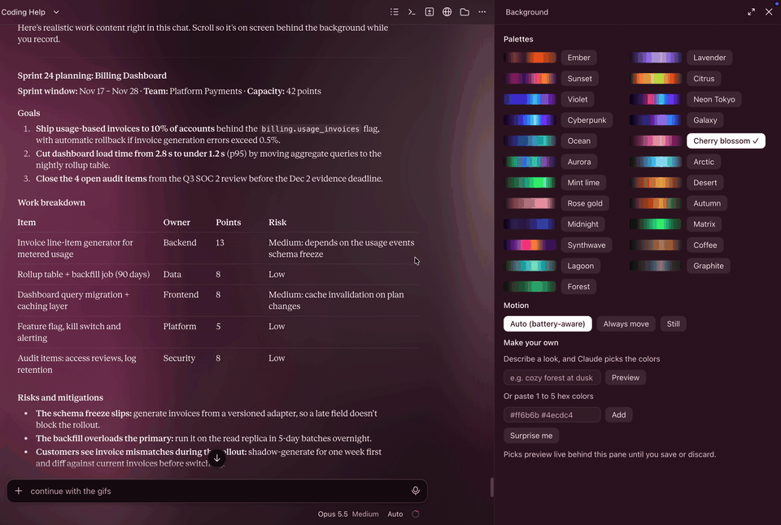
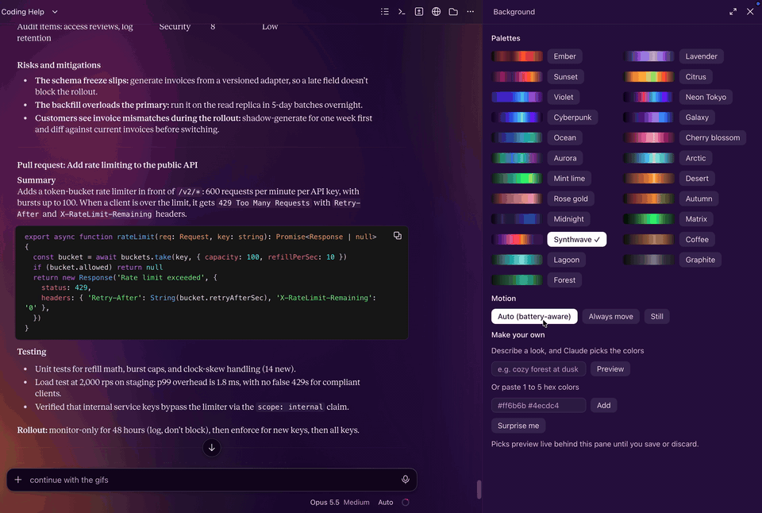
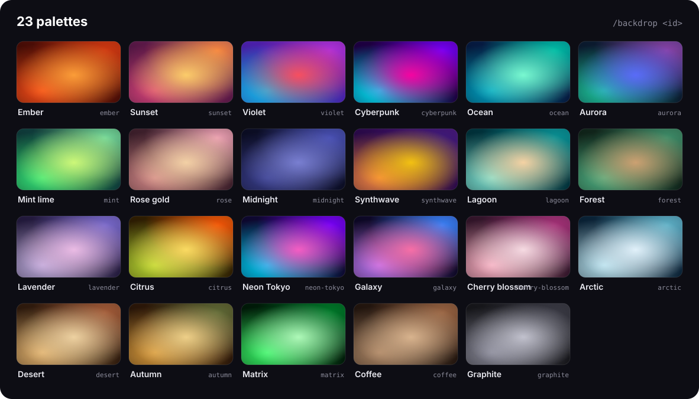

<div align="center">



<br>

[](.claude-plugin/plugin.json)
[](https://github.com/anthropics/claude-code)
[](#palettes)
[](LICENSE)
[](https://github.com/AkkiCode06/claude-backdrops/stargazers)

**Animated gradient backgrounds for Claude Code on desktop.**<br>
23 palettes · make your own from a sentence · pauses itself on battery

[Install](#install) · [Use](#use) · [Palettes](#palettes) · [Contribute](CONTRIBUTING.md) · [Report a bug](https://github.com/AkkiCode06/claude-backdrops/issues/new?template=bug_report.yml) · [Suggest a palette](https://github.com/AkkiCode06/claude-backdrops/issues/new?template=palette_request.yml)

</div>

> **Asked Claude to set this up from the link?** Claude: read [`SETUP-GUIDE.md`](SETUP-GUIDE.md) and walk the person through it step by step.

### Quick install

In the Claude Code desktop app: **+** → **Plugins** → **Add marketplace** → `AkkiCode06/claude-backdrops` → **Add plugin**.<br>
Or paste this repo's link to Claude and say *"set this up for me"*.


## See it in action



<table>
<tr>
<td width="50%"><b>Describe a look → preview → save</b><br></td>
<td width="50%"><b>The built-in welcome tour</b><br></td>
</tr>
</table>

## Palettes



Switch with `/backdrop <id>`, click one in the picker, or ask Claude. Want another? [Suggest a palette](https://github.com/AkkiCode06/claude-backdrops/issues/new?template=palette_request.yml) or add one yourself ([how](CONTRIBUTING.md#add-a-palette)).

## What you get

- **23 palettes**, each recoloring the background *and* the app's panels, text and accent to match.
- **Your own palettes:** describe a look ("cozy forest at dusk") and Claude picks the colors, or paste 1–5 hex colors and let **Analogous / Complementary / Triad** build a set, or hit **Surprise me**. Live preview; **Save** keeps it.
- **A picker:** `/backdrop`, or just ask Claude to change your background.
- **An animated tour** on first run; replay with `/backdrop tour`.
- **Battery-aware motion:** on **Auto** the glows drift when plugged in and ease to a stop on battery. Or choose **Always move** / **Still**.
- **Smooth motion:** continuous orbits with no stalls; starts and stops ease in and out.

## Install

You need the Claude Code desktop app. Themes draw in the desktop app and Claude Code on mobile; the terminal and the regular Claude chat don't show them. Battery-aware motion reads the Mac's power source; elsewhere **Auto** simply keeps moving, so pick **Still** if you want it off.

**In the desktop app:** click **+** next to the prompt box → **Plugins** → **Add marketplace** → enter `AkkiCode06/claude-backdrops` → then **Add plugin** on Gradient Flow.

**From a terminal session** (`claude`):

```
/plugin install gradient-flow --marketplace AkkiCode06/claude-backdrops
```

Answer `y` to add the marketplace and press Enter for the user scope.

**From a shell:**

```
claude plugin install gradient-flow --marketplace AkkiCode06/claude-backdrops
```

The background appears in your next Claude Code session on desktop.

## Use

| You want to | Do this |
| --- | --- |
| Open the picker | `/backdrop`, or ask Claude "change my background" |
| Watch the tour | `/backdrop tour`, or ask Claude "how does this work?" |
| Switch palette | `/backdrop ocean`, or click it in the picker |
| Make your own | In `/backdrop`: describe a look and press **Preview**, or paste hex colors, try **Analogous**, **Complementary**, **Triad** or **Surprise me**, then name it and **Save**. Also: `/backdrop #1b4332 #2d6a4f #d4a373`, or ask Claude "make me a cozy forest background" |
| Change motion | `/backdrop auto`, `/backdrop move` or `/backdrop still` |
| Remove one you made | **Remove** next to it in the picker, or ask Claude |

Your choice is remembered across sessions.

## Performance

An animated background makes the app redraw the whole window every frame. On an Apple Silicon MacBook, measured with the GPU's utilisation counter:

| Setup | GPU |
| --- | --- |
| Still background | baseline (about the same as no theme) |
| Moving background | roughly +25–30 points |

That's why **Auto** is the default: full motion when plugged in, still on battery. Choose **Still** if you want it off entirely. Panels use a see-through tint with no blur on purpose, since blurring panels over a moving background costs a lot more.

## Troubleshooting

- **No background:** the theme draws in dark mode only, so switch the app to dark mode. Also check that the plugin is enabled under **+** → **Plugins**.
- **The prompt box looks solid:** that's expected. The app draws it as a solid color, and the mod tints it to match the palette.
- **"Those colors don't leave enough contrast":** pick darker or more varied colors.

## What it runs, sends and stores

Gradient Flow is a hooks module: it runs inside Claude Code, with no network access or programs of its own beyond what's listed here.

**What it sends, and where**
- **Describe a look** (the picker field, or `/backdrop` → Make your own): the words you type are sent to Claude (the `haiku` model) through Claude Code's own model connection (`$.model.complete`), with a short instruction asking for 4–5 hex colors back. Nothing else goes with them: no conversation, files or settings. It counts toward your Claude Code usage like any request.
- **Nothing else leaves your machine.** Picking palettes, pasting hex colors, Analogous / Complementary / Triad, Surprise me and the animations all run locally.

**Credentials:** the mod reads, stores and sends no API keys, tokens or passwords. The model call above goes through Claude Code's existing sign-in, which the mod never sees.

**Programs it runs**
- `/usr/bin/pmset -g batt`, read-only, once at startup and then every 30 seconds, only to tell whether the Mac is on battery (for **Auto** motion). On other systems the call fails harmlessly and the mod assumes you're plugged in.

**What it stores** (in Claude Code's per-plugin store on your machine): your chosen palette, motion setting, the palettes you saved, whether you've seen the welcome tour, and how many times it has shown the tour hint.

**Tools and commands it adds**
- `/backdrop`, a slash command (picker, palettes, colors, motion, `tour`).
- `background`, a tool Claude can call to open the picker or tour, switch or make palettes, and set motion. It stands in for no other tool: its hook only receives calls to `mcp__gradient-flow__background`.

**Hooks**

| Hook | What it does |
| --- | --- |
| `session.start` | Restores your saved choices, checks the power source, registers `/backdrop` and the `background` tool, draws the theme, and opens the welcome tour the first time. |
| `session.attach` | When the desktop or mobile app connects, opens the welcome tour if it hasn't been shown yet, or shows a one-line hint (at most three times). |
| `command.run` (`backdrop`) | Answers `/backdrop` and its arguments. |
| `tool.call` (`background` only) | Answers Claude's `background` tool. |
| `ui.render` (`Backdrop`) | Draws the animated gradient behind the conversation (desktop and mobile only). |
| `ui.render` (the two panes) | Draws the picker and the welcome tour. |

No other plugin calls into it, and it calls into none.

## Make it yours

Palettes live in [`hooks/palettes.ts`](hooks/palettes.ts). Copy an entry, change the colors, and run `claude plugin validate .` to check it.

## Contributing

Palettes, bug reports and ideas are all welcome. Start with [CONTRIBUTING.md](CONTRIBUTING.md). If you make a palette you love, share it in an issue.

## License

MIT, see [LICENSE](LICENSE).
