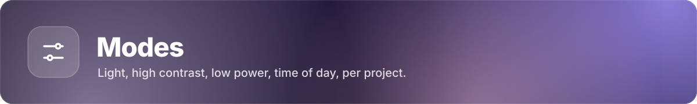
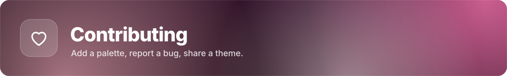

 

**The open-source theming kit for Claude Code.** 
Theme Claude Code without writing a mod: **pick** a palette, **describe** a look, or **paste** some colors.

[Install](#install) · [How to use](#how-to-use) · [Make your own](#make-your-own) · [Palettes](#palettes) · [Styles](#styles) · [Reactive](#reactive) · [Modes](#modes) · [**Theme guide**](docs/making-themes.md) · [**Kit reference**](docs/kit.md) · [**Share your theme**](#community-themes) · [Roadmap](#roadmap) · [Privacy](#privacy)

> [!TIP]
> **Community themes wanted!** Theming in Claude Code is brand new, and this is meant to grow into a shared library of themes, made by you or by your Claude. Made one you like? [Open a pull request](#community-themes) with a screenshot or a short clip.

> **Asked Claude to set this up from the link?** Claude: read [`SETUP-GUIDE.md`](SETUP-GUIDE.md) and walk the person through it step by step.

### Why a kit?

Claude Code can now load theme mods, but making one yourself means writing a hooks file, SVG scenes and color tokens, then reloading to see each change. Backdrop does that part once, so theming is just a picker:

| Without a kit | With Backdrop |
| --- | --- |
| Write or ask Claude to write a mod for every theme | Install once, then pick, describe or paste colors |
| Reload to see each change | Live preview behind the picker |
| Work out readable text and panel colors yourself | Panels, text and accents are derived from your colors automatically |
| Each theme lives on one machine | Share yours with a PR; it ships to everyone, credited to you |

**What's in the kit:**

- 🧱 **A block library** for building backgrounds: `k.sky()`, `k.stars()`, `k.aurora()`, `k.codeRain()`, `k.skyline()` and more. A whole new style is about 10 lines, with no SVG or animation code. ([Reference](docs/kit.md))
- 🎬 **11 styles** built with it: Gradient, Starfield, Waves, Synthwave, Aurora, Rain, Snow, Code rain, Lava lamp, Geometric and Pixel city
- 🧑‍💻 **Reacts to Claude:** glows while it thinks, shimmers while it works, flashes and notifies you when it's done, and warns you as you near your usage limit
- 🎛️ **Modes:** light, high contrast, low power, time of day and per-project themes
- 📦 **Themes as files:** export, import, one-line share codes, and a community folder
- 🛠️ **Tools:** `new-style` and `new-theme` scaffolds, a browser preview, checkers that run in CI, and a JSON schema for theme files

It's also a **base to build on**: fork it, add palettes or whole new background styles, and send them back. See [Share your theme](#community-themes) and the [Roadmap](#roadmap).

 

**Requirements:** the Claude Code desktop app, in dark mode. Themes draw in the desktop app and in Claude Code on mobile. The terminal and the regular Claude chat don't show them.

| Where | How |
| --- | --- |
| **Desktop app** (easiest) | Click **+** next to the prompt box → **Plugins** → **Add marketplace** → `AkkiCode06/claude-backdrops` → **Add plugin** |
| **Let Claude do it** | Paste this repo's link into a Code session and say *"set this up for me"* |
| **Terminal session** | `/plugin install gradient-flow --marketplace AkkiCode06/claude-backdrops`, then `y` and Enter |
| **Shell** | `claude plugin install gradient-flow --marketplace AkkiCode06/claude-backdrops` |

Start a new Code session: the background appears and a short animated tour opens.

**Update:** `claude plugin update gradient-flow`. **Remove:** **+** → **Plugins** → remove, or `claude plugin uninstall gradient-flow`.

 

| You want to | Type or say |
| --- | --- |
| Open the picker | `/backdrop`, or *"change my background"* |
| Switch palette | `/backdrop ocean`, click one in the picker, or *"make it synthwave"* |
| Switch style | `/backdrop style aurora` (gradient, starfield, waves, synthwave, aurora, rain, snow, code-rain, lava-lamp, geometric, city), or the **Style** row in the picker |
| Modes | `/backdrop light` · `dark` · `contrast` · `lowpower` · `timeofday` · `perproject` (add `no-` to turn one off), or the **Modes** row |
| Reactive layer | `/backdrop no-reactive` · `no-meter` · `no-alerts` to turn parts off, or the **Reactive** row |
| Share a theme | `/backdrop share` copies a one-line code; `/backdrop export` saves a `.json` file; `/backdrop import <code, file or JSON>` loads one |
| Pause or resume motion | `/backdrop still` · `/backdrop move` · `/backdrop auto` |
| Watch the tour | `/backdrop tour`, or *"how does this work?"* |
| See what's available | *"what backgrounds are there?"* |

Your palette and motion setting are remembered across sessions.

<b>Motion settings explained</b>

- **Auto** (default): the glows drift while you're plugged in, ease to a stop over about 8 seconds on battery, and ease back up when you plug in again. It checks every 30 seconds. Battery detection is Mac-only; elsewhere Auto keeps moving.
- **Always move:** keeps moving on battery too.
- **Still:** the same picture, frozen. Uses almost no GPU.

 

Open `/backdrop` and scroll to **Make your own**:

1. **Describe a look:** type something like *"sunset in LA"* or *"cozy forest at dusk"* and press **Preview**. Claude picks 4–5 colors and the background switches to them live.
2. **Or paste hex colors:** 1–5 colors from any color picker, e.g. `#0b1026 #3a0ca3 #f72585`.
3. **Tweak:** **Analogous**, **Complementary** or **Triad** build a matching set from your first color. **Surprise me** rolls a random one.
4. **Keep it:** name it and press **Save**, or **Discard** to go back.

Shortcuts: `/backdrop #1b4332 #2d6a4f #d4a373` makes one straight from the prompt, and *"make me a cozy forest background"* has Claude do it all. You can keep up to 12 palettes, and the picker can remove them.

The mod works out readable panels, text and accent colors from whatever you pick.

**→ Full walkthrough, from no-code to building a new background style: [How to make your own themes](docs/making-themes.md)**

 

Each palette recolors the background *and* the app's panels, text and accent color to match. Want one added? [Suggest a palette](https://github.com/AkkiCode06/claude-backdrops/issues/new?template=palette_request.yml), or [add it yourself](#contributing).

 

Every style works with every palette and theme. Switch with `/backdrop style <id>` or the **Style** row. A theme can pick the style it was made for. Want a new one? Run `node --experimental-strip-types scripts/new-style.ts <id>` and see the [kit reference](docs/kit.md).

 

For the coders: the backdrop shows what Claude is doing, on top of any style.

| When | You see |
| --- | --- |
| Claude is **thinking** | A soft glow breathing along the bottom |
| Claude is **running tools** | A brighter glow, with a shimmer sweeping the bottom edge |
| Claude is **done** | One bright flash, plus a desktop notification if the turn took over 20 seconds |
| Something **failed** | A red pulse |
| Your **5-hour usage** climbs | A thin bar along the bottom edge, green → amber → red. The edges warm at 80% and pulse at 95%, and you get a heads-up toast at both |
| The **context window** fills | A hairline above the usage bar, turning amber past 80% |

Turn any part off in the picker's **Reactive** row, or with `/backdrop no-reactive`, `no-meter` or `no-alerts`. The picker also shows a live status line: what Claude is doing, usage % and context %.

 

| Mode | What it does |
| --- | --- |
| **Light** | A light version of every palette and style: pale tinted panels, dark text, pastel glows |
| **High contrast** | Stronger borders and text, and a darker band behind the chat |
| **Low power** | Fewer, simpler moving elements, for older Macs |
| **Time of day** | The palette follows the clock: Midnight at night, Rose at dawn, Ocean in the morning, Lagoon in the afternoon, Sunset at golden hour, Ember at dusk, Galaxy in the evening |
| **Per project** | Remembers a palette for each folder, so you always know which repo you're in |

All of these sit alongside **Motion** (Auto / Always move / Still) and combine freely. Seasonal packs (Halloween, Winter night, Spring bloom, Summer haze, Northern lights, Terminal green) ship as community themes.

 

A moving background makes the app redraw the whole window every frame. Measured on an Apple Silicon MacBook:

| Setup | GPU use |
| --- | --- |
| Still background | about the same as no theme |
| Moving background | roughly +25–30 points |

That's why **Auto** is the default. Panels use a see-through tint with no blur on purpose, because blurring panels over a moving background costs a lot more.

 

Gradient Flow is a hooks module: it runs inside Claude Code, with no network access or programs of its own beyond what's listed here.

| | |
| --- | --- |
| **Sends** | Only when you use **Describe a look**: your words go to Claude (the `haiku` model) through Claude Code's own model connection (`$.model.complete`), with a short instruction asking for 4–5 hex colors. No conversation, files or settings go with them, and it counts toward your usage like any request. Everything else runs locally. |
| **Credentials** | None. The mod reads, stores and sends no API keys, tokens or passwords. The model call goes through Claude Code's existing sign-in, which the mod never sees. |
| **Runs** | `/usr/bin/pmset -g batt`, read-only, at startup and every 30 seconds, only to tell whether the Mac is on battery. On other systems the call fails harmlessly. |
| **Watches** | For the reactive layer only, and nothing leaves your machine: when a turn starts and ends (and whether it errored), the **names** of tools Claude runs (never their inputs or outputs), and the usage and context percentages Claude Code already shows in its status line. |
| **Notifies** | When a long turn finishes, a desktop notification through Claude Code's own `$.ui.notify` ("Claude is done"). Turn it off with `/backdrop no-alerts`. |
| **Stores** | In Claude Code's per-plugin store on your machine: your palette, style, motion and mode settings, saved palettes, whether you've seen the tour, and, with **Per project** on, which palette goes with which folder path. Theme files you export go to `~/.claude/backdrop/themes/`. |
| **Adds** | The `/backdrop` command, and a `background` tool Claude can call. It stands in for no other tool: the hook that answers it only receives calls to `mcp__gradient-flow__background`. A second `tool.call` hook only watches tool names for the reactive layer: it passes every call through unchanged and returns exactly what the tool returned. |

<b>Every hook, and what it does</b>

| Hook | What it does |
| --- | --- |
| `session.start` | Restores your saved choices, checks the power source, registers `/backdrop` and the `background` tool, draws the theme, and opens the welcome tour the first time. |
| `session.attach` | When the desktop or mobile app connects, opens the welcome tour if it hasn't been shown yet, or shows a one-line hint (at most three times). |
| `command.run` (`backdrop`) | Answers `/backdrop` and its arguments. |
| `tool.call` (`background` only) | Answers Claude's `background` tool. |
| `ui.render` (`Backdrop`) | Draws the animated gradient behind the conversation (desktop and mobile only). |
| `ui.render` (the two panes) | Draws the picker and the welcome tour. |
| `turn.start` / `turn.complete` | Watch only: mark Claude as thinking, then done or errored, for the reactive glow and the done notification. Main-thread turns only. |
| `tool.call` (all tools, watching) | Watch only: marks Claude as working while a tool runs. Passes every call through untouched. |
| `session.measure` | Watch only: reads the usage and context percentages for the usage meter. |

No other plugin calls into it, and it calls into none.

 

Theming Claude Code only just became possible, so there's no shared library of themes yet. **Let's build one.** Every theme that gets merged ships to everyone who has backdrop, with your name on it.

**Share yours in four steps:**

1. **Make it:** in `/backdrop`, describe a look or paste hex colors, and **Save** it once you love it. Or ask your Claude to design one. ([Theme guide](docs/making-themes.md))
2. **Add it:** `/backdrop export`, then copy the file from `~/.claude/backdrop/themes/` into this repo's [`themes/`](themes) folder. Set `author` to your GitHub handle so the picker credits you.
3. **Check it:** `node --experimental-strip-types scripts/check-themes.ts`. A GitHub check runs it on your PR too.
4. **Open a PR** using the **theme** template, with **a screenshot or a short clip** of it running. A few pictures are plenty. Theme PRs get the `theme` label automatically, and new styles get `style`.

Not ready to open a PR? [Drop your colors in an issue](https://github.com/AkkiCode06/claude-backdrops/issues/new?template=palette_request.yml) and someone can pick it up.

 

The goal: a **Spicetify-style theme marketplace for Claude Code**, where anyone can publish, browse and install themes made by people or by Claude.

| Status | What |
| --- | --- |
| ✅ Done | 23 built-in palettes, make-your-own (describe or hex), `/backdrop` picker, battery-aware motion, welcome tour |
| ✅ Done | **The kit:** theme files with export/import, and the style kit with Gradient, Starfield, Waves and Synthwave |
| ✅ Done | **11 styles** and the expanded kit (aurora, code rain, blobs, shapes, skyline, vignette, dots), with a preview script, scaffolds and CI checks |
| ✅ Done | **Reacts to Claude:** thinking/working glow, done flash and notification, error pulse, usage and context meters |
| ✅ Done | **Modes:** light, high contrast, low power, time of day, per-project themes; seasonal packs |
| ✅ Done | **Share codes** (`/backdrop share`), a theme JSON schema, and a style gallery |
| 🚧 Now | **Community themes and styles via pull requests**, credited in the picker |
| 🔜 Next | **Focus mode:** a calm, near-still backdrop while Claude is working, which wakes up when it's done |
| 🔜 Next | **Your own image:** any wallpaper or photo behind your chats (waiting on Claude Code support for larger images) |
| 🔜 Next | **Following the system's light/dark setting** automatically |
| 💭 Later | A browsable theme gallery with one-click install, plus ratings and tags |

**More styles wanted.** Still to come: a cozy pixel-art room, fireflies, ocean depths, a lofi café… or whatever you think of. Each style is one small file built from kit blocks, so it makes a great first PR: `node --experimental-strip-types scripts/new-style.ts <id>`, then see the [kit reference](docs/kit.md). [Open an issue](https://github.com/AkkiCode06/claude-backdrops/issues/new) to claim one.

 

| Problem | Fix |
| --- | --- |
| No background | Switch the app to **dark mode**, check the plugin is enabled under **+** → **Plugins**, then start a new session. |
| The tour didn't open | Run `/backdrop tour`. |
| The prompt box looks solid | That's expected: the app draws it as a solid color, and the mod tints it to match. |
| Fans spin up, or the battery drains | Use `/backdrop still`, or leave it on **Auto**. |
| "Those colors don't leave enough contrast" | Pick darker or more varied colors. |
| `claude: command not found` in your terminal | The app installs it to `~/.local/bin`, so add that folder to your `PATH`. |

Still stuck? [Open a bug report](https://github.com/AkkiCode06/claude-backdrops/issues/new?template=bug_report.yml).

 

Themes are the easiest way in ([see above](#community-themes)). Bug fixes, docs and features are welcome too. The full guide, including labels and how PRs get reviewed, is in [CONTRIBUTING.md](CONTRIBUTING.md).

- [Suggest a palette](https://github.com/AkkiCode06/claude-backdrops/issues/new?template=palette_request.yml)
- [Report a bug](https://github.com/AkkiCode06/claude-backdrops/issues/new?template=bug_report.yml)
- Made a palette you love? Share it in an issue, and it might ship as a preset.

 

MIT licensed · made for Claude Code's mods by [AkkiCode06](https://github.com/AkkiCode06)

