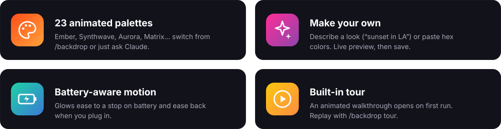
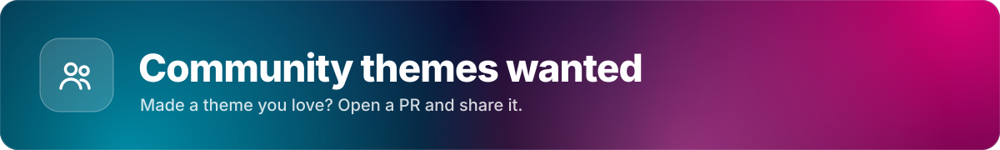
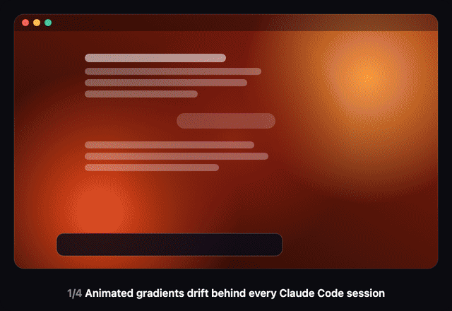

 

**Animated gradient backgrounds for Claude Code on desktop.** 
23 palettes · make your own from a sentence · pauses itself on battery

[Install](#install) · [How to use](#how-to-use) · [Make your own](#make-your-own) · [Palettes](#palettes) · [**Share your theme**](#community-themes) · [Roadmap](#roadmap) · [Privacy](#privacy)

> [!TIP]
> **Community themes wanted!** Theming in Claude Code is brand new, and this is meant to grow into a shared library of themes, made by you or by your Claude. Made one you like? [Open a pull request](#community-themes) with a screenshot or a short clip.

> **Asked Claude to set this up from the link?** Claude: read [`SETUP-GUIDE.md`](SETUP-GUIDE.md) and walk the person through it step by step.

 

**Requirements:** the Claude Code desktop app, in dark mode. Themes draw in the desktop app and in Claude Code on mobile. The terminal and the regular Claude chat don't show them.

| Where | How |
| --- | --- |
| **Desktop app** (easiest) | Click **+** next to the prompt box → **Plugins** → **Add marketplace** → `AkkiCode06/claude-backdrops` → **Add plugin** |
| **Let Claude do it** | Paste this repo's link into a Code session and say *"set this up for me"* |
| **Terminal session** | `/plugin install gradient-flow --marketplace AkkiCode06/claude-backdrops`, then `y` and Enter |
| **Shell** | `claude plugin install gradient-flow --marketplace AkkiCode06/claude-backdrops` |

Start a new Code session: the background appears and a short animated tour opens.

**Update:** `claude plugin update gradient-flow`. **Remove:** **+** → **Plugins** → remove, or `claude plugin uninstall gradient-flow`.

 

| You want to | Type or say |
| --- | --- |
| Open the picker | `/backdrop`, or *"change my background"* |
| Switch palette | `/backdrop ocean`, click one in the picker, or *"make it synthwave"* |
| Pause or resume motion | `/backdrop still` · `/backdrop move` · `/backdrop auto` |
| Watch the tour | `/backdrop tour`, or *"how does this work?"* |
| See what's available | *"what backgrounds are there?"* |

Your palette and motion setting are remembered across sessions.

<b>Motion settings explained</b>

- **Auto** (default): the glows drift while you're plugged in, ease to a stop over about 8 seconds on battery, and ease back up when you plug in again. It checks every 30 seconds. Battery detection is Mac-only; elsewhere Auto keeps moving.
- **Always move:** keeps moving on battery too.
- **Still:** the same picture, frozen. Uses almost no GPU.

 

Open `/backdrop` and scroll to **Make your own**:

1. **Describe a look:** type something like *"sunset in LA"* or *"cozy forest at dusk"* and press **Preview**. Claude picks 4–5 colors and the background switches to them live.
2. **Or paste hex colors:** 1–5 colors from any color picker, e.g. `#0b1026 #3a0ca3 #f72585`.
3. **Tweak:** **Analogous**, **Complementary** or **Triad** build a matching set from your first color. **Surprise me** rolls a random one.
4. **Keep it:** name it and press **Save**, or **Discard** to go back.

Shortcuts: `/backdrop #1b4332 #2d6a4f #d4a373` makes one straight from the prompt, and *"make me a cozy forest background"* has Claude do it all. You can keep up to 12 palettes, and the picker can remove them.

The mod works out readable panels, text and accent colors from whatever you pick.

 

Each palette recolors the background *and* the app's panels, text and accent color to match. Want one added? [Suggest a palette](https://github.com/AkkiCode06/claude-backdrops/issues/new?template=palette_request.yml), or [add it yourself](#contributing).

 

A moving background makes the app redraw the whole window every frame. Measured on an Apple Silicon MacBook:

| Setup | GPU use |
| --- | --- |
| Still background | about the same as no theme |
| Moving background | roughly +25–30 points |

That's why **Auto** is the default. Panels use a see-through tint with no blur on purpose, because blurring panels over a moving background costs a lot more.

 

Gradient Flow is a hooks module: it runs inside Claude Code, with no network access or programs of its own beyond what's listed here.

| | |
| --- | --- |
| **Sends** | Only when you use **Describe a look**: your words go to Claude (the `haiku` model) through Claude Code's own model connection (`$.model.complete`), with a short instruction asking for 4–5 hex colors. No conversation, files or settings go with them, and it counts toward your usage like any request. Everything else runs locally. |
| **Credentials** | None. The mod reads, stores and sends no API keys, tokens or passwords. The model call goes through Claude Code's existing sign-in, which the mod never sees. |
| **Runs** | `/usr/bin/pmset -g batt`, read-only, at startup and every 30 seconds, only to tell whether the Mac is on battery. On other systems the call fails harmlessly. |
| **Stores** | In Claude Code's per-plugin store on your machine: your palette, motion setting, saved palettes, and whether you've seen the tour. |
| **Adds** | The `/backdrop` command, and a `background` tool Claude can call. It stands in for no other tool: its hook only receives calls to `mcp__gradient-flow__background`. |

<b>Every hook, and what it does</b>

| Hook | What it does |
| --- | --- |
| `session.start` | Restores your saved choices, checks the power source, registers `/backdrop` and the `background` tool, draws the theme, and opens the welcome tour the first time. |
| `session.attach` | When the desktop or mobile app connects, opens the welcome tour if it hasn't been shown yet, or shows a one-line hint (at most three times). |
| `command.run` (`backdrop`) | Answers `/backdrop` and its arguments. |
| `tool.call` (`background` only) | Answers Claude's `background` tool. |
| `ui.render` (`Backdrop`) | Draws the animated gradient behind the conversation (desktop and mobile only). |
| `ui.render` (the two panes) | Draws the picker and the welcome tour. |

No other plugin calls into it, and it calls into none.

 

Theming Claude Code only just became possible, so there's no shared library of themes yet. **Let's build one.** Every theme that gets merged ships to everyone who has backdrop, with your name on it.

**Share yours in four steps:**

1. **Make it:** in `/backdrop`, describe a look or paste hex colors, and **Save** it once you love it. Or ask your Claude to design one.
2. **Add it:** fork this repo and add an entry to [`hooks/palettes.ts`](hooks/palettes.ts), with `author: '<your GitHub handle>'` so the picker credits you.
3. **Check it:** `claude plugin validate .` and `claude plugin test .`. A test makes sure Claude Code can paint it.
4. **Open a PR** using the **theme** template, with **a screenshot or a short clip** of it running. A few pictures are plenty. PRs that touch `hooks/palettes.ts` get the `theme` label automatically.

Not ready to open a PR? [Drop your colors in an issue](https://github.com/AkkiCode06/claude-backdrops/issues/new?template=palette_request.yml) and someone can pick it up.

 

The goal: a **Spicetify-style theme marketplace for Claude Code**, where anyone can publish, browse and install themes made by people or by Claude.

| Status | What |
| --- | --- |
| ✅ Done | 23 built-in palettes, make-your-own (describe or hex), `/backdrop` picker, battery-aware motion, welcome tour |
| 🚧 Now | **Community themes via pull requests**, credited in the picker |
| 🔜 Next | Themes as standalone files you can share with a link, and import/export from the picker |
| 🔜 Next | **Light mode:** light versions of the palettes, plus themes that follow the system's light/dark setting |
| 🔜 Next | **High-contrast mode:** stronger borders and text for readability and accessibility |
| 🔜 Next | **Focus mode:** a calm, near-still backdrop while Claude is working, which wakes up when it's done |
| 🔜 Next | **Time-of-day mode:** palettes that shift with the clock, from sunrise to midnight |
| 🔜 Next | **More background styles** beyond gradient glows (see below) |
| 💭 Later | **Status mode:** the backdrop reacts to what Claude is doing (thinking, running tools, done, error) |
| 💭 Later | **Per-project themes:** a different palette for each repo, so you always know where you are |
| 💭 Later | **Seasonal and event packs**, plus a low-power mode tuned for older Macs |
| 💭 Later | A browsable theme gallery with one-click install, plus ratings and tags |

**Background styles on the way.** Gradients are just the first style. Each of these would come with its own palettes and its own motion:

| Style | What it looks like |
| --- | --- |
| 🖼️ **Your own image** | Any wallpaper or photo behind your chats, with readable panels on top |
| ✨ **Starfield** | Slow-drifting stars and the occasional shooting star |
| 🌊 **Waves** | Layered sine waves rolling along the bottom of the window |
| 🌧️ **Rain and snow** | Gentle falling particles, with weather packs |
| 🌌 **Aurora ribbons** | Northern-lights curtains swaying across the top |
| 🌆 **Synthwave grid** | A retro horizon with a glowing sun and a scrolling grid |
| 💚 **Code rain** | Falling characters, Matrix-style |
| 🫧 **Lava lamp** | Big soft blobs that merge and split |
| 🔷 **Geometric** | Slowly rotating shapes, low-poly fields and dot grids |
| 👾 **Pixel art** | Tiny animated pixel scenes: a cozy room, a city at night |

Want to build one? Each style is just an animated SVG scene, so a style is a great first PR. [Open an issue](https://github.com/AkkiCode06/claude-backdrops/issues/new) to claim one, or suggest your own.

 

| Problem | Fix |
| --- | --- |
| No background | Switch the app to **dark mode**, check the plugin is enabled under **+** → **Plugins**, then start a new session. |
| The tour didn't open | Run `/backdrop tour`. |
| The prompt box looks solid | That's expected: the app draws it as a solid color, and the mod tints it to match. |
| Fans spin up, or the battery drains | Use `/backdrop still`, or leave it on **Auto**. |
| "Those colors don't leave enough contrast" | Pick darker or more varied colors. |
| `claude: command not found` in your terminal | The app installs it to `~/.local/bin`, so add that folder to your `PATH`. |

Still stuck? [Open a bug report](https://github.com/AkkiCode06/claude-backdrops/issues/new?template=bug_report.yml).

 

Themes are the easiest way in ([see above](#community-themes)). Bug fixes, docs and features are welcome too. The full guide, including labels and how PRs get reviewed, is in [CONTRIBUTING.md](CONTRIBUTING.md).

- [Suggest a palette](https://github.com/AkkiCode06/claude-backdrops/issues/new?template=palette_request.yml)
- [Report a bug](https://github.com/AkkiCode06/claude-backdrops/issues/new?template=bug_report.yml)
- Made a palette you love? Share it in an issue, and it might ship as a preset.

 

MIT licensed · made for Claude Code's mods by [AkkiCode06](https://github.com/AkkiCode06)

