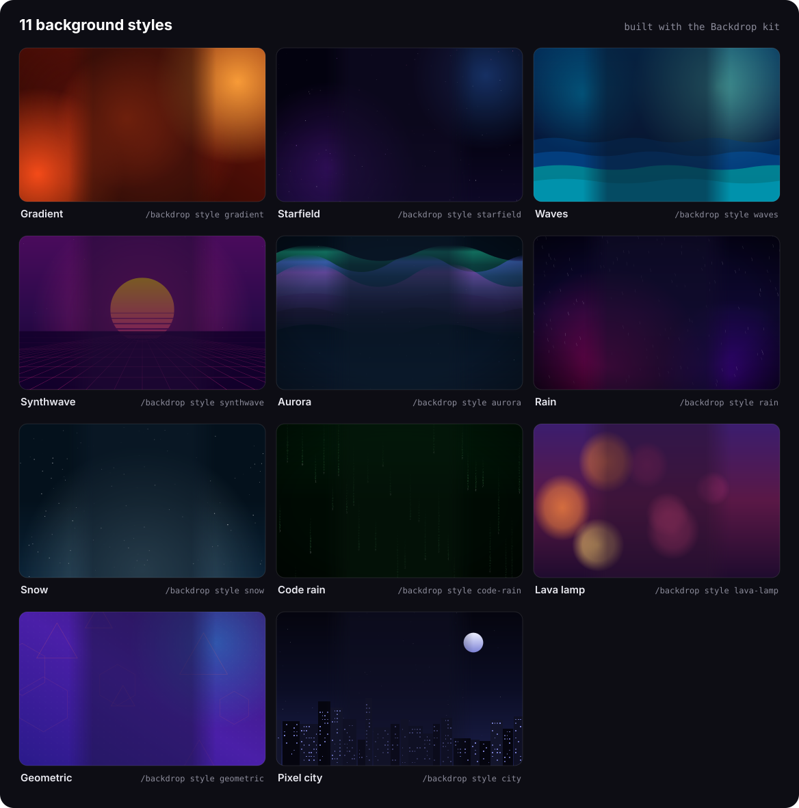

# The Backdrop kit: reference

The kit is a small TypeScript library for building Claude Code backgrounds out of blocks. You never write SVG or animation code: you stack blocks, and the kit handles animation, battery mode, low-power mode, reacting to Claude, unique ids, the size limit and the reading column.

New here? Start with the [theme guide](making-themes.md). This page is the full reference.

- [Quick start](#quick-start)
- [The style file](#the-style-file)
- [Blocks](#blocks)
- [Helpers: k.random, k.pick, k.count, k.state](#helpers)
- [Theme files](#theme-files)
- [Scripts](#scripts)
- [Rules the kit enforces](#rules-the-kit-enforces)



---

## Quick start

```bash
node --experimental-strip-types scripts/new-style.ts fireflies "Fireflies"   # scaffold + register
node --experimental-strip-types scripts/preview.ts fireflies                  # see it in your browser
node --experimental-strip-types scripts/check-styles.ts                       # check it everywhere
```

Then load your fork in Claude Code (`claude --plugin-dir .`) and run `/backdrop style fireflies`.

## The style file

Each style is one file in [`hooks/styles/`](../hooks/styles), listed in [`hooks/styles/index.ts`](../hooks/styles/index.ts):

```ts
import { style } from '../kit'

export default style({
  id: 'fireflies',                 // used by /backdrop style fireflies
  name: 'Fireflies',               // shown in the picker
  description: 'warm lights drifting up through a dusky forest',  // for the picker and Claude
  layers: (k, p) => [              // k = the kit, p = the palette being drawn
    k.sky([p.base[0], p.base[1], p.base[2]]),
    k.glow({ at: [0.5, 0.9], size: 1, color: p.glows[1], opacity: 0.4 }),
    k.particles({ count: 50, color: p.glows[4], direction: 'up', speed: 0.5 }),
  ],
  // readingColumn: false,         // opt out of the darker band behind the chat
})
```

Layers draw in order, back to front. Every style works with every palette, so use palette colors (`p.base`, `p.glows`, `p.surfaces`, `p.text`, `p.roles`) rather than fixed hex codes where you can.

**Positions** are fractions of the canvas: `[0, 0]` top-left, `[1, 1]` bottom-right. **Sizes** are fractions of the canvas width. **Durations** are in seconds. The canvas is 1600 × 1000 and fills any window (it's cropped, never stretched), so keep important things away from the very edges.

## Blocks

Every option is optional; the defaults are tuned to look good.

### Backgrounds

| Block | Options (defaults) | Draws |
| --- | --- | --- |
| `k.sky(colors, { angle })` | `angle: 'vertical'` or `'diagonal'` | A gradient filling the canvas, `colors` bottom to top |
| `k.vignette({ color, strength })` | `'#000000'`, `0.55` | Darkened (or tinted) edges |
| `k.dots({ spacing, size, color, opacity })` | `36`, `1.6`, `p.text.muted`, `0.22` | A static dot grid (very cheap) |

### Light

| Block | Options (defaults) | Draws |
| --- | --- | --- |
| `k.glow({ at, size, color, opacity, orbit })` | `[0.5, 0.5]`, `0.45`, `p.glows[0]`, `0.85`; `orbit: { rx, ry, seconds }` | A soft round glow; with `orbit`, it drifts around an ellipse |
| `k.glows({ count, opacity, seconds })` | `5`, `0.9`, `22` | Several drifting palette glows (the classic gradient look) |
| `k.sun({ at, size, colors, stripes })` | `[0.5, 0.5]`, `0.22`, glows 4→1, `true` | A sun or moon, optionally with retro stripes |
| `k.aurora({ count, colors, top, height, seconds, opacity })` | `3`, glows 2/4/3, `0.08`, `0.3`, `18`, `0.5` | Northern-lights curtains swaying across the top |

### Things that move

| Block | Options (defaults) | Draws |
| --- | --- | --- |
| `k.stars({ count, size, colors, twinkle, drift, seconds })` | `100`, `[0.6, 1.8]`, whites and glows, `0.45`, `40`, `80` | Twinkling, slowly drifting stars. `drift: 0` holds them still |
| `k.shootingStar({ every, from, to, color })` | `11`, `[0.78, 0.12]`, `[0.5, 0.33]`, `'#ffffff'` | A streak across the sky every `every` seconds |
| `k.particles({ count, color, size, speed, direction, streak, opacity })` | `70`, `p.text.primary`, `[1, 2.6]`, `1`, `'down'`, `false`, `0.6` | Rain (`streak: true`, fast), snow (slow), embers or fireflies (`direction: 'up'`) |
| `k.waves({ count, colors, height, amplitude, seconds, opacity })` | `4`, glows, `0.35`, `28`, `14`, `0.55` | Layered waves rolling along the bottom |
| `k.blobs({ count, colors, size, seconds, opacity })` | `6`, glows, `[0.12, 0.26]`, `26`, `0.75` | Lava-lamp blobs rising and sinking |
| `k.shapes({ count, sides, size, color, width, seconds, opacity })` | `9`, `[3, 4, 6]`, `[60, 180]`, `p.roles.accent`, `2`, `60`, `0.35` | Outlined polygons slowly turning |
| `k.codeRain({ columns, color, head, size, speed, chars, opacity })` | `34`, `p.roles.success`, `'#ffffff'`, `18`, `1`, katakana and symbols, `0.55` | Matrix-style falling characters |
| `k.grid({ color, horizon, lines, seconds, opacity })` | `p.roles.accent`, `0.62`, `14`, `3`, `0.55` | A retro perspective grid scrolling toward you |
| `k.skyline({ colors, window, height, pixel, lit })` | base/surface tones, `p.glows[4]`, `0.42`, `8`, `0.35` | A pixel-art city with flickering windows |

### Escape hatch

| Block | Draws |
| --- | --- |
| `k.raw(svg, defs?)` | Any SVG you like, in canvas pixels. Put gradients and the like in `defs`. Animate with SMIL (`<animate>`, `<animateTransform>`), and skip the animation when `!k.moving` |

## Helpers

| Helper | What it gives you |
| --- | --- |
| `k.random()` | A seeded random number in 0..1. The same style and palette always draw the same scene |
| `k.pick(list)` | One item from a list, at random (seeded) |
| `k.count(n)` | `n` normally, about 40% of `n` in low-power mode. The blocks already use it; use it in `k.raw` loops too |
| `k.moving` | `false` when the scene should be still (on battery, or motion off). Blocks drop their animation then |
| `k.lowPower` | `true` in low-power mode |
| `k.state.activity` | `'idle'`, `'thinking'`, `'working'`, `'done'` or `'error'`: what Claude is doing |
| `k.state.usage` | How much of the 5-hour usage window is used, 0..1 |
| `k.state.context` | How full the context window is, 0..1 |
| `k.palette` | The palette (also passed as `p`) |

**Reacting to Claude.** The reactive layer (activity glow, usage meter) is drawn on top of every style automatically. Your style can react too:

```ts
layers: (k, p) => [
  k.sky([p.base[0], p.base[1]]),
  // Stars twinkle more while Claude is working.
  k.stars({ count: 100, twinkle: k.state.activity === 'working' ? 0.9 : 0.3 }),
  // A warning-colored glow once usage passes 80%.
  ...(k.state.usage > 0.8 ? [k.glow({ at: [0.5, 1], size: 1.2, color: p.roles.warning, opacity: 0.3 })] : []),
]
```

The scene is redrawn when the activity changes and when usage moves by 2% or more.

## Theme files

A theme is a JSON file: either the quick format (1–5 `colors`; Backdrop works out the rest) or the full format (every color). There's a [JSON Schema](../themes/schema.json) for editor autocomplete: put `"$schema": "./schema.json"` at the top.

```json
{ "$schema": "./schema.json", "id": "rainy-tokyo", "name": "Rainy Tokyo",
  "author": "your-github-handle", "style": "rain",
  "colors": ["#05061a", "#2b2d7a", "#ff2e88", "#00c2ff", "#ffd1f0"] }
```

| Where a theme lives | Who sees it |
| --- | --- |
| `themes/<id>.json` in this repo | Everyone, under **Community**, credited to `author` |
| `~/.claude/backdrop/themes/<id>.json` | Just you, under **Yours**. Drop a file in, then **Reload theme files** |
| A share code `bd1.…` | Whoever you send it to: `/backdrop import bd1.…` |

`/backdrop export` writes the current theme to your folder, and `/backdrop share` copies a share code.

## Scripts

All run from the repo root with `node --experimental-strip-types scripts/<name>.ts`. Node 22.6 or newer.

| Script | Does |
| --- | --- |
| `new-style.ts <id> ["Name"]` | Creates `hooks/styles/<id>.ts` from a template and registers it |
| `new-theme.ts <id> ["Name"] [handle]` | Creates `themes/<id>.json` |
| `preview.ts [style] [palette]` | Writes `preview/index.html`: each style moving and still, with its size. Open it in a browser |
| `check-styles.ts` | Every style × every palette × dark and light × normal and low power × moving and still |
| `check-themes.ts` | Every theme file parses, has a unique id and a known style, and Claude Code can paint it |
| `style-gallery.ts` | Regenerates `assets/styles.svg` |
| `gallery.ts assets` | Regenerates `assets/palettes.svg` and `assets/features.svg` |
| `banners.ts assets/banners` | Regenerates the README banners |

CI runs `check-themes` and `check-styles` on every pull request.

## Rules the kit enforces

| Rule | Why |
| --- | --- |
| SMIL animation only, no CSS `@keyframes` or `<style>` | CSS animation can freeze in the desktop app |
| No `feGaussianBlur` | Re-blurring every frame pinned the GPU at 100%. Glows use radial gradients |
| Under 131,072 characters per scene | Claude Code's limit for a backdrop. `check-styles` tells you how close you are |
| No animation when still | Battery mode and **Still** must cost almost nothing |
| No scripts, no external files | The scene runs in a sandbox that loads nothing |
