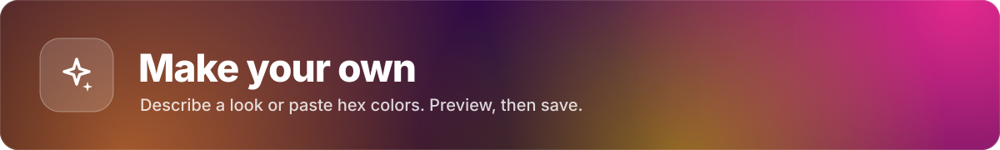

# How to make your own Claude Code themes

Backdrop gives you four ways to make a theme, from zero code to building a whole new background style. Start at level 1 and go as deep as you like.

| Level | You'll need | Time |
| --- | --- | --- |
| [1. In the picker](#level-1-in-the-picker-no-code) | Nothing, just Backdrop installed | 1 minute |
| [2. Ask Claude](#level-2-ask-claude) | A sentence | 1 minute |
| [3. Add it to the kit](#level-3-add-a-palette-to-the-kit) | A text editor | 10 minutes |
| [4. A new background style](#level-4-build-a-new-background-style) | Some SVG and TypeScript | an afternoon |

> New here? [Install Backdrop first](../README.md#install). Every level below works in the Claude Code desktop app, in dark mode.

---

## Level 1: in the picker (no code)

Open the picker with `/backdrop` and scroll to **Make your own**.

**Describe a look.** Type a mood or a place and press **Preview**:

- *"sunset in LA"*
- *"cozy forest at dusk"*
- *"neon Tokyo, rainy night"*
- *"lavender latte"*

Claude picks 4–5 colors, and the background switches to them live, behind the picker.

**Or paste colors.** Grab 1–5 hex codes from any color picker (coolors.co, Figma, a brand guide) and paste them in, e.g. `#0b1026 #3a0ca3 #f72585 #4cc9f0`. Press **Add**.

**Tweak.** With at least one color picked:

| Button | What it does |
| --- | --- |
| **Analogous** | Neighbours of your first color on the color wheel: calm, cohesive |
| **Complementary** | Your color plus its opposite: punchy contrast |
| **Triad** | Three evenly spaced hues: bright and playful |
| **Surprise me** | A random set, for when you're stuck |

Click a hex tag to remove that color.

**Keep it.** Type a name and press **Save**. It appears under **Yours** in the picker and is remembered across sessions (up to 12). **Discard** goes back to what you had.

You never pick panel, text or accent colors yourself: Backdrop derives them from your colors, and darkens the panels until text is readable.

---

## Level 2: ask Claude

With Backdrop installed, Claude has a `background` tool, so you can just say:

- *"Make me a background that feels like a rainy Tokyo night"*
- *"Use my brand colors: #0a2540 #635bff #00d4ff"*
- *"Make it warmer"* or *"Less purple"*
- *"Save this one as Midnight Run"*
- *"Stop the animation"* or *"Only move when I'm plugged in"*

Claude picks the colors, previews them and saves the palette.

---

## Level 3: add a palette to the kit

Want your theme built in for everyone, credited to you? Add it to [`hooks/palettes.ts`](../hooks/palettes.ts) and open a pull request.

### 1. Copy an entry

```ts
{
  id: 'rainy-tokyo',            // lowercase, hyphens: used by /backdrop rainy-tokyo
  name: 'Rainy Tokyo',          // shown in the picker
  author: 'your-github-handle', // shown as "by @your-github-handle"
  base: ['#05061a', '#0d1033', '#1a1240'],
  glows: ['#2b2d7a', '#ff2e88', '#00c2ff', '#6a3cff', '#ffd1f0'],
  surfaces: ['#10122a', '#151733', '#1a1c3c', '#1d1f41'],
  text: { primary: '#f4f3ff', secondary: '#d4d2f0', muted: '#b2afd6' },
  roles: { accent: '#ff2e88', danger: '#ff5d7a', success: '#5fe0b0', warning: '#ffc04d', pro: '#a88bff' },
},
```

> **Shortcut:** make it in the picker first (level 1). The colors you saved are a good starting point.

### 2. What each field does

| Field | What it colors | Rules of thumb |
| --- | --- | --- |
| `base` (3) | The gradient behind everything, bottom-left → top-right | Very dark, the same family as your glows |
| `glows` (5) | The five moving blobs, largest and most central first | Make the first two deep tones and the rest brighter. These carry the mood |
| `surfaces` (4) | Panels, cards, the prompt box and menus, darkest first | Dark, close together (a few % apart), tinted toward your hue |
| `text` | Primary, secondary and muted text | Primary near white. Muted still needs to be readable on `surfaces[0]` |
| `roles.accent` | Buttons, links, highlights and code keywords | Your signature color: bright, but readable on dark |
| `roles.danger / success / warning` | Errors, success, warnings | Keep them red, green and amber, tuned toward your palette |
| `roles.pro` | A secondary highlight, also used for literals in code | Any color that sits well next to the accent |

### 3. Recipes that work

- **Moody:** a near-black base, two deep glows of one hue, three brighter glows of a neighbouring hue. *(Ember, Midnight)*
- **Neon:** a dark base, glows in two opposite hues (pink and cyan), and an accent from one of them. *(Cyberpunk, Neon Tokyo)*
- **Soft:** a muted base, pastel glows, and surfaces with a little more color. *(Lavender, Rose gold)*
- **Nature:** greens or blues, plus one warm glow (amber or gold) as a "light source". *(Forest, Lagoon)*

Things to avoid: pure black or white surfaces, surfaces far apart in brightness, and very bright glows right in the center (they sit behind the chat text).

### 4. Check it

```bash
claude plugin validate .
claude plugin test .
```

One test checks that Claude Code can paint every palette. If it fails, darken your `surfaces` or lighten `text.muted`. The error says which pair is too close.

Then try it for real: run Claude Code with your fork loaded (`claude --plugin-dir .`), then `/backdrop rainy-tokyo`.

### 5. Share it

1. Optional: refresh the gallery with `node --experimental-strip-types scripts/gallery.ts assets`.
2. Open a pull request with the **theme** template (add `?template=theme.md` to the new-PR URL).
3. Add **a screenshot or a short clip** of it running. A few pictures are plenty.

Your PR is labeled `theme` automatically. Once it's merged, everyone gets it on their next update, credited to you in the picker.

---

## Level 4: build a new background style

Gradients are just the first style. Starfields, waves, synthwave grids, code rain and pixel art are all on the [roadmap](../README.md#roadmap), and each one is a great first big PR.

### How a background works

Claude Code's theme API takes a **backdrop scene**, which the mod draws as **one SVG**:

1. `hooks/register.tsx` calls `$.theme.set({ colors, backdrop: { scene: '<name>' } })`.
2. The desktop app asks the mod's `ui.render` hook for `{ component: 'Backdrop' }`.
3. The hook returns `<Svg source={...} isInteractive />`, and the app draws it full-window behind the conversation.

The gradient style lives in [`hooks/scene.ts`](../hooks/scene.ts): `buildScene(palette, mode)` returns the SVG text for the moving, easing-to-stop and still versions.

### Rules the app imposes (learned the hard way)

| Rule | Why |
| --- | --- |
| **Animate with SMIL** (`<animate>`, `<animateTransform>`, `<animateMotion>`), not CSS `@keyframes` | CSS animation and `@media` rules can leave the scene frozen in the desktop app |
| **No full-screen `feGaussianBlur`** | Redrawing a blur every frame pinned the GPU at 100%. Use radial gradients for softness |
| **Keep it under 131,072 characters** | A hard limit on `Svg` source |
| **No scripts, no external files** | The scene runs in a sandboxed frame with nothing loaded |
| **`viewBox` plus `preserveAspectRatio="xMidYMid slice"`** | Fills any window size, from phone to ultrawide |
| **Keep the middle calm** | The chat sits there. Backdrop also lays a darker "reading column" down the center |
| **Provide a still version** | Battery mode swaps to a frame with no animation, which is almost free on the GPU |

### Steps

1. Write a function like `buildScene` that takes a `Palette` and a mode (`flow`, `settle`, `still`) and returns SVG text. Use the palette's colors so every palette works with your style.
2. Preview it in a browser first: write the SVG to a file and open it.
3. Wire it into `register.tsx` next to the gradient scene. A `style` setting in the picker is the plan; open an issue first and we'll agree on the shape together.
4. Measure the GPU while it runs. On a Mac: `ioreg -r -d 1 -w 0 -c IOAccelerator | grep "Device Utilization"`. Compare it against the gradient style.
5. Open a PR with a clip. It's labeled `core` automatically.

### Handy references

- The plugin-authoring docs for Claude Code mods: the `look.md` and `reference.md` that come with the skill
- [`hooks/scene.ts`](../hooks/scene.ts): orbits, easing and the battery-aware stop
- [`hooks/tour.ts`](../hooks/tour.ts): a longer SMIL animation with captions and typing effects

---

## Troubleshooting your theme

| Problem | Fix |
| --- | --- |
| "Those colors don't leave enough contrast" | Your darkest color is too light. Add a deeper tone, or let Backdrop derive surfaces from darker picks |
| The panels look gray and dull | Tint your `surfaces` toward your main hue (e.g. `#1a1240` rather than `#1a1a1a`) |
| Code is hard to read | `roles.accent` and `roles.success` color code. Make them brighter |
| The test says Desktop won't paint it | Darken `surfaces[3]`, or lighten `text.muted`. The message names the pair |
| Nothing changed after editing | Start a new session, or `/reload-plugins` |

Questions? [Open an issue](https://github.com/AkkiCode06/claude-backdrops/issues/new), or share what you made in a [palette idea](https://github.com/AkkiCode06/claude-backdrops/issues/new?template=palette_request.yml).
